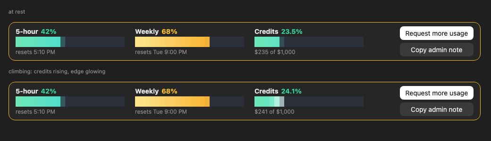

# usage-meter

A Claude Code mod (Desktop and terminal) by [Shaheer Shoaib](https://github.com/shaheershoaib): your live 5-hour, weekly and usage-credit usage above the prompt, and a button that sends a usage-credit request to your organization's admins.



## Install

Paste this in a terminal:

```bash
curl -fsSL https://raw.githubusercontent.com/shaheershoaib/usage-meter/main/install.sh | bash
```

Then open a new Claude Code session. That's it. Run the same line again any time to update.

It downloads the mod to `~/.claude/mods/usage-meter` and adds it to `CLAUDE_CODE_PLUGIN_DIRS` in `~/.claude/settings.json` (your other settings are kept, and a backup is made first). Needs `python3` or `node`, which most machines have.

To remove it:

```bash
curl -fsSL https://raw.githubusercontent.com/shaheershoaib/usage-meter/main/uninstall.sh | bash
```

<details>
<summary>Or install from the plugin marketplace</summary>

In Claude Code:

```
/plugin marketplace add shaheershoaib/usage-meter
/plugin install usage-meter@usage-meter
```

Claude Code is still rolling out mods for marketplace plugins. If nothing appears after a new session, use the install line above instead.
</details>

## What it does

- **5-hour, Weekly and Credits** bars ease up as your usage rises, refreshed after each turn and every minute while you work. Every open session shares one lookup, so they never hammer Anthropic's usage endpoint.
- **Request more usage** asks you to confirm, then sends a usage-credit request to your organization's admins (Team and Enterprise). It checks first, so a request that is already pending is never sent twice. The button stays, so you can ask again any time, and your last request shows beside it as a small status (in every session). `/more-usage` does the same from the prompt.
- **Copy admin note** puts a ready-to-send message about your usage on the clipboard.

## Good to know

- Requires a Claude Code build with mods (2.1.286 or later) and a claude.ai sign-in. Tested on macOS; `install.sh` works on macOS and Linux.
- usage-meter reads the same usage and admin-request endpoints Claude Code itself uses. They are not a published API, so a future Claude Code release could change them.
- Everything runs locally in Claude Code. Nothing is sent anywhere except those Anthropic requests, made with your own sign-in.
- Pairs with [agent-warehouse](https://github.com/shaheershoaib/agent-warehouse), which shows your session's agents as robots in a warehouse.

## License

[Apache 2.0](LICENSE): free to use, modify, and share, including commercially. Keep the [`NOTICE`](NOTICE) file with any redistribution (§4(d)), and don't market a fork under the `usage-meter` name (§6). The patent grant in §3 means adopting this doesn't expose you to a patent claim over it.

Required Notice: Copyright Shaheer Shoaib (https://github.com/shaheershoaib)
